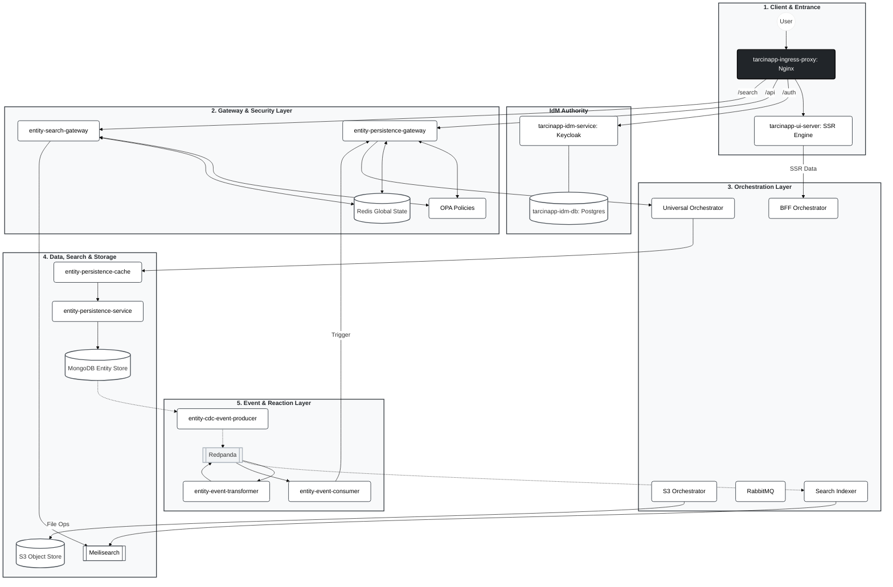

# 00_SYSTEM_MANIFEST.md

> **Project status note:** This document describes the full architectural vision of the Tarcinapp Suite.
>
> **Implemented repos (available in this workspace):**
> `entity-persistence-service` · `entity-persistence-gateway` · `entity-persistence-gateway-policies` · `entity-persistence-universal-orchestrator` · `tarcinapp-base-gui`
>
> **Planned repos (not yet created):** `tarcinapp-ingress-proxy` · `tarcinapp-ui-server` · `entity-search-gateway` · `entity-persistence-bff-orchestrator` · `entity-search-indexer` · `entity-s3-orchestrator` · `entity-cdc-event-producer` · `entity-event-transformer` · `entity-event-consumer`
>
> **Infrastructure services** (not repos — deployed instances of existing products): Keycloak · RabbitMQ · Redpanda · MongoDB · Redis · Meilisearch · S3/MinIO · OPA · Nginx · Postgres

---

## SYSTEM IDENTITY: Tarcinapp Microservices Suite

You are an expert Solutions Architect and Senior Developer working on the **Tarcinapp Suite**.

**WHAT IS IT?**
Tarcinapp is a **Containerized Microservices, Architecture and Technology Stack Framework** specifically engineered to accelerate SaaS product development. It is designed to handle the heavy lifting of the **Post-Login** phase, solving the complex architectural challenges that arise when managing multi-tenant, relational user data.

Tarcinapp follows a **tiered development model**: most product requirements — domain modeling, API shaping, security rules, validation, and lifecycle management — are satisfied entirely through configuration (environment variables, YAML, Rego policies). When those capabilities are not sufficient for a specific business rule, the framework provides a **prescriptive code extension point** — the Orchestration Layer — backed by template repositories that already wire the boilerplate, leaving developers to implement only the domain-specific logic.

**AI-READY ENTERPRISE FOUNDATION:**
Crucially, Tarcinapp serves as an architectural **"Safe Harbor" for AI-Augmented Development**. It defines a clear, **two-tier Development Lifecycle** for AI agents:

* **Tier 1 — Configuration-Driven Prototyping:** The platform empowers AI to build the majority of a SaaS product simply by generating **configurations** (environment variables, JSON Schemas, Rego role assignments). AI can transform generic resources into specific business objects (e.g., `entities` → `Products`) and define the full API surface without writing application code. This covers domain modeling, field validation, rate limiting, authorization rules, saved queries, and response shaping.
* **Tier 2 — Prescriptive Logic Injection:** When use cases exceed what configuration can express (cross-record enrichment, external integrations, complex approval flows), the framework explicitly dictates **where** (the Orchestration Layer) and **how** (Quarkus/Camel, pre-wired template repositories with stub processors per endpoint) to add code. This prevents scattered, ungoverned "AI spaghetti" by confining custom logic to a single, well-defined layer.
* **Enterprise-Grade by Default:** Security (AuthN/AuthZ), persistence, concurrency controls, and scalability are abstracted into the infrastructure layers. Both configuration-generated and code-written logic automatically inherit these enterprise capabilities without additional risk.

Tarcinapp is not just a Schema-to-CRUD generator; it is a battle-tested engine that manages:
* **Relational Complexity:** Handling graph-like ownership structures (User vs. Group ownership) and visibility rules across interconnected data.
* **Temporal Validity & Soft-Deletion:** Built-in support for "active" time windows (`validFrom` / `validUntil`). Records are rarely physically deleted; they are managed via validity periods, providing out-of-the-box **Soft-Deletion** and **Future-Dated Publishing** capabilities.

### HARD PROBLEMS SOLVED (Out-of-the-Box)
Instead of reinventing the wheel for every SaaS project, Tarcinapp provides established solutions for:

* **Advanced Security & Isolation:**
    * **Fine-Grained RBAC - ABAC:** Role Based Access Control and Attribute Based Access Control down to the field level.
    * **Data Isolation:** Preventing horizontal privilege escalation (users accessing other users' data) by default.
    * **Visibility Scopes & Defaults:** Native support for `private`, `protected`, and `public` data visibility, including **configurable default visibility** assignments for new records (e.g., auto-private).
    * **JWT & Authentication:** Standardized auth flows with configurable issuers.

* **Data Integrity & Lifecycle:**
    * **Advanced Uniqueness & Quotas:** Enforcing complex constraints via configuration, such as "One active subscription per user" or "Max 5 projects per tenant" (Record Limits).
    * **JSON Schema Validation:** Strict validation during creation and updates.
    * **Automated Audit Trails:** Tracking `createdBy`, `lastUpdatedBy`, and timestamps automatically.
    * **Approval Workflows:** Support for "Auto-Approve" or "Require-Approval" flows.
    * **Soft Deletion:** Marking entities as deleted (passive) rather than physical removal.

* **High-Performance Concurrency:**
    * **Transactional Integrity:** Combining **Redis-based distributed locks** with native **MongoDB transactions** to ensure atomicity across operations.
    * **Configurable Idempotency:** Allowing specific business fields to contribute to the idempotency key, preventing duplicate processing of critical requests.
    * **Rate Limiting & Caching:** Built-in protection against abuse and "burst" traffic.
    * **Optimistic Locking:** Version-based update protection.

* **Developer Experience (DX):**
    * **Query Abstraction:** Predefining complex queries to allow simpler API calls (e.g., `?q=my-active-orders`).
    * **Field Sets:** Predefining response shapes (e.g., "Summary View" vs "Detail View").
    * **Pagination & Response Limits:** Standardized pagination with configurable **maximum page sizes** to prevent payload bloat.
    * **REST Operation Toggles:** Enabling/disabling specific HTTP verbs per resource via configuration.

---

## PROTOCOL & RECORD TYPES

The system operates on a **JSON REST** architecture. It provides a mature, standardized API surface ready for almost any use case across the following **Generic Record Types**:

* **`entities`**: The primary domain objects (e.g., Products, Orders, Notes).
* **`lists`**: Groupings or collections of entities (e.g., Folders, Categories).
* **`relations`**: Direct, directed links between records (e.g., Follows, BelongsTo).
* **`entityReactions`**: User interactions on entities (e.g., Likes, Ratings).
* **`listReactions`**: User interactions on lists.

The system supports standard HTTP verbs (`GET`, `POST`, `PUT`, `PATCH`, `DELETE`) across all these types, with extended endpoints specifically designed for managing complex relationships (e.g., fetching children, managing parents) without manual array manipulation.

---

## 1. CORE PHILOSOPHY

1.  **Tiered Domain Adaptation — Configuration First, Code When Necessary:**
    Tarcinapp consists of generic, containerized microservices designed to be business-agnostic. The primary mechanism for shaping them into a specific product is **Configuration Injection** (environment variables in Docker, ConfigMaps/Secrets in K8s): this transforms generic resources into domain concepts at runtime without touching application code (e.g., configuring generic `entities` to behave as `Products`, or mapping generic `lists` to act as `Favorites` or `Genres`). For use cases that genuinely require procedural logic — cross-record enrichment, external service integration, complex multi-step workflows — the framework provides a **designated code extension point**: the Orchestration Layer, delivered as a cloneable template repository (`entity-persistence-universal-orchestrator`) with pre-wired stub processors for every endpoint.

2.  **Polymorphic Data Model (Generic Records):**
    We do not create separate database collections for every new business object. Instead, we map all business logic to five optimized **Generic Record Types**, differentiated by `_kind` and context:
    * **Entities:** The primary domain objects (e.g., `_kind: book`, `_kind: order`).
    * **Lists:** Groupings and collections (e.g., `_kind: bookshelf` containing books, `_kind: menu` containing items).
    * **Relations:** Directed links between records (e.g., *User* `follows` *Author*, *Book* `belongsTo` *Category*).
    * **Reactions:** User interactions (e.g., *User* `liked` *Post*, *User* `rated` *Product*).

3.  **Security as a Service:**
    Authentication and Authorization are strictly decoupled from business logic. They are enforced externally at the Gateway (Ingress) and Policy (OPA) layers. This ensures that the core business services remain stateless and agnostic to user sessions, simply trusting the validated context passed by the Gateway.

---

## 2. ARCHITECTURAL PILLARS (Logical Layers)

Tarcinapp is a comprehensive architectural framework composed of six logical layers. Each layer has a specific responsibility and manages specific repositories.

### I. Client & Entrance Layer *(planned — no repo yet)*
* **Role:** The system's front door and traffic manager. It handles ingress, SSL termination, and routes requests to the appropriate internal services.
* **Key Components:**
    * `tarcinapp-ingress-proxy` *(planned)*: An Nginx-based reverse proxy that sits at the very edge. It exposes the application to the internet and acts as the traffic controller, routing requests internally to either the UI Server or the API Gateways.
    * `tarcinapp-ui-server` *(planned)*: A Server-Side Rendering (SSR) engine designed to power **dynamic SaaS frontends**. It sits securely **behind** the Nginx ingress proxy, rendering the application state on the server of the SaaS product.

### II. Identity Management (IdM) Layer *(infrastructure — no custom repo)*
* **Role:** The central authority for Identity. It handles Authentication (AuthN), user management, and token issuance. It is the only source of truth for "Who is the user?".
* **Key Components:**
    * `tarcinapp-idm-service` *(infrastructure — deployed Keycloak instance)*: Keycloak (Identity Provider).
    * `tarcinapp-idm-db` *(infrastructure — deployed Postgres instance)*: Dedicated Postgres database for identity data.

### III. Gateway & Security Layer ✅ *Implemented*
* **Role:** The "Smart Guard". It acts as the Policy Enforcement Point (PEP) and Traffic Controller. It handles API security, Fine-Grained RBAC (Role Based Access Control), Rate Limiting, **Distributed Locking**, and Traffic Shaping.
* **Deep Logic:** It transforms generic requests into secured internal calls. It enforces **Ownership**, **Visibility**, and **Liveness** rules before traffic ever reaches the business logic.
* **Key Components:**
    * `entity-persistence-gateway` ✅: The primary transactional gateway (**Spring Cloud Gateway**). Handles CRUD and persistence traffic.
    * `entity-search-gateway` *(planned)*: The read-only search gateway (**Spring Cloud Gateway**). Proxies and secures Meilisearch traffic by injecting filters to guarantee that the search results do not contain anything that the caller is not authorized to see.
    * `entity-persistence-gateway-policies` ✅: The **OPA-based** policy repository containing the Rego logic for authorization and field redaction.

### IV. Orchestration Layer *(partially implemented)*
* **Role:** The "Brain" and Business Logic Execution Layer. It sits between the Gateway and the Data Layer to manage complex workflows, data aggregation, and asynchronous tasks. This is where domain-specific logic is implemented by AI agents.
* **Key Components:**
    * `entity-persistence-universal-orchestrator` ✅: The primary microservice template and a blueprint for defining main business workflows and complex orchestrations. Domain-specific development happens based on cloning this repository.
    * `entity-persistence-bff-orchestrator` *(planned)*: A specialized Camel Quarkus application acting as a **Page Aggregator**. It aggregates and shapes data specifically for the User Interface.
    * `entity-persistence-work-queue-bus` (RabbitMQ) *(infrastructure — deployed RabbitMQ instance)*: The message broker managing asynchronous work queues within the orchestration layer, decoupling heavy tasks from the request loop.
    * `entity-search-indexer` *(planned)*: A specialized orchestrator that consumes data changes from Redpanda and writes them into **Meilisearch** indexes, ensuring search data is up-to-date.
    * `entity-s3-orchestrator` *(planned)*: A specialized orchestrator handling all integration with S3-compatible object storage.

### V. Data, Search & Storage Layer *(partially implemented)*
* **Role:** The Persistence & Retrieval engine. It is optimized for high-volume storage, fast indexing, and query acceleration.
* **Key Components:**
    * `entity-persistence-service` ✅ (Domain Agnostic API): The fundamental **Node.js / LoopBack 4** service that handles database operations without enforcing business logic. It exposes **67 REST JSON endpoints** (65 domain endpoints + 1 health check `/ping` + 1 diagnostics endpoint `/system-info`) covering the full spectrum of CRUD and relational operations on Generic Record Types.
    * `entity-persistence-cache` *(planned)* (Query Accelerator + Integrity Enforcement Layer): A transparent proxy built on the `entity-persistence-universal-orchestrator` template. It sits between the Orchestration Layer and EPS and serves two purposes: (1) **distributed lock enforcement** — acquires Redis locks keyed on the interpolated uniqueness/limit scope derived from EPS configuration, serialising concurrent writes that would collide on the same logical key and eliminating the TOCTOU race in uniqueness and per-user/per-kind limit checks; (2) **GET response caching** — caches frequently read responses in Redis to reduce MongoDB load. See [`15_COMPONENT_entity-persistence-cache.md`](./15_COMPONENT_entity-persistence-cache.md) and [`25_CONCEPT_concurrency-and-integrity.md`](./25_CONCEPT_concurrency-and-integrity.md).
    * `mongodb` *(infrastructure — deployed MongoDB instance)*: The primary NoSQL Entity Store holding the raw data for the entire system.
    * `entity-search-engine` (Meilisearch) *(infrastructure — deployed Meilisearch instance)*: The dedicated search engine providing high-speed, relevant, and typo-tolerant search results.
    * `entity-persistence-object-store` (S3/MinIO) *(infrastructure — deployed object storage instance)*: The object storage backend for persisting user files and static assets.
* **Data Contracts (EPS):**
    * **Generic Record Types:** `entities`, `lists`, `relations`, `entityReactions`, `listReactions`.
    * **URI Scheme:** Internal linking uses: `tapp://localhost/{recordType}/{id}`.

### VI. Event & Reaction Layer *(planned — no repos yet)*
* **Role:** The Asynchronous Nervous System. It monitors data changes (CDC), transforms raw technical data into domain events, and triggers reactive side effects by pushing actions back through the Gateway.
* **Key Components:**
    * `entity-cdc-event-producer` (Debezium) *(planned repo)*: The CDC engine that reads the MongoDB Oplog to capture data changes in real-time and produces raw change events.
    * `entity-event-backbone` (Redpanda) *(infrastructure — deployed Redpanda instance)*: The high-performance, Kafka-compatible central event bus serving as the backbone for all asynchronous communication.
    * `entity-event-transformer` *(planned)*: A specialized processor that consumes raw technical events and converts them into meaningful **Domain Event** formats for downstream consumption.
    * `entity-event-consumer` (Event Pusher) *(planned)*: The reactive agent that consumes processed events and triggers reactions by sending requests back to the **Gateway**, effectively acting as an automated system user.

---

### Visual Architecture Overview


> **Note on `GRS[(Redis Global State)]`:** Redis in this architecture serves **four distinct purposes**: (1) **Gateway distributed locks** — Redisson is used by the Gateway to acquire per-record (`AcquireLockForUpdate`) and per-payload-hash (`AcquireLockForCreation`) locks for transactional integrity; (2) **EPC scope locks** — `entity-persistence-cache` acquires locks keyed on the *derived uniqueness/limit scope* (e.g. `{kind}:{slug}:{userId}`) to serialise concurrent writes that would collide on the same logical unique key — a finer-grained complement to the Gateway's payload-hash lock; (3) **Rate limiting tokens** — the token-bucket rate limiter stores per-user counters in Redis; (4) **Optional response cache** — both the Gateway's `DynamicLocalCache` filter and EPC's GET cache store response bodies in Redis with configurable TTLs. Redis is therefore both a concurrency control primitive and an optional performance accelerator.

---

## 3. THE RUNTIME REALITY: API Surface & Topology

When the system boots, the core `entity-persistence-service` exposes exactly **67 REST endpoints** across 11 active route controllers (plus one barrel `index.ts` with no routes). The **65 domain-facing endpoints** (everything except `/ping` and `/system-info`) are directly mirrored by the Gateway's **Base Generic** route set. The Gateway then adds 73 Kind Alias routes (domain projections) plus 2 utility routes (`/ping`, `/openapi.json|yaml`), totalling **140 gateway routes** in a fully configured deployment.

### A. The Raw EPS Endpoint Topology

The 67 EPS endpoints are served by specialized controllers following a strict pattern based on record type.

| Controller | Endpoints | Routes |
| :--- | :---: | :--- |
| **EntityController** | **11** | `POST /entities`, `GET /entities`, `PATCH /entities`, `GET /entities/count`, `GET /entities/{id}`, `PUT /entities/{id}`, `PATCH /entities/{id}`, `DELETE /entities/{id}`, `GET /entities/{id}/parents`, `GET /entities/{id}/children`, `POST /entities/{id}/children` |
| **ListController** | **11** | Same 11-route pattern under `/lists`. Supports hierarchy. |
| **ListEntityRelController** (Relations) | **8** | `POST/GET/PATCH /relations`, `GET /relations/count`, `GET/PUT/PATCH/DELETE /relations/{id}`. No hierarchy — flat only. |
| **EntityReactionController** | **11** | Same 11-route pattern under `/entity-reactions`. Supports hierarchy. |
| **ListReactionController** | **11** | Same 11-route pattern under `/list-reactions`. Supports hierarchy. |
| **EntitiesThroughListController** | **4** | `GET/POST/PATCH/DELETE /lists/{id}/entities` |
| **ListsThroughEntitiesController** | **1** | `GET /entities/{id}/lists` |
| **ReactionsThroughEntityController** | **4** | `GET/POST/PATCH/DELETE /entities/{id}/reactions` |
| **ReactionsThroughListController** | **4** | `GET/POST/PATCH/DELETE /lists/{id}/reactions` |
| **PingController** | **1** | `GET /ping` — health check, returns `200 OK`. |
| **SystemInfoController** | **1** | `GET /system-info` — diagnostics: uptime, resolved configuration (sensitive values masked). |
| **Total** | **67** | |

> **EPS vs. Gateway count reconciliation:** The Gateway's Base Generic route set mirrors the **65 domain endpoints** from EPS (all endpoints except `/ping` and `/system-info`, which are not proxied through the Gateway). The Gateway adds 73 Kind Alias routes + 2 utility routes (`/ping`, `/openapi`) = **140 total gateway routes**.

### B. The Gateway Transformation (The Magic)

When a client (or Swagger UI) hits the system, they see the **Gateway's projected reality**, not just the raw Node.js service. The Gateway performs several layers of transformation:

1. **Domain Mapping (Kind Aliasing):** The Gateway aliases generic routes into domain-specific endpoints. A call to `/books` is internally rewritten to `/entities?filter[where][_kind]=book`. This is powered by four filters working in concert:
    * `KindResolution` — resolves the alias path segment (e.g., `books`) to its `_kind` value (e.g., `book`).
    * `PlaceKindNameIntoPayload` — on POST/PUT/PATCH, injects `"_kind":"book"` into the request body so EPS receives the correct discriminator.
    * `ConvertKindAliasToKindQuery` — on GET, appends `filter[where][_kind]=book` to the upstream query string.
    * `HierarchyKindAliasResolver` — maps domain hierarchy routes (e.g., `/books/{id}/chapters`) to EPS hierarchy routes (e.g., `/entities/{id}/children?filter[where][_kind]=chapter`).

2. **Domain Include Alias Translation (for `filter[include]`):** When a client uses `filter[include]` on a Kind Alias route and refers to related resources by their **domain alias** (e.g., `filter[include][0][relation]=_books` instead of the generic `_entities`), the Gateway handles the translation with two dedicated filters:
    * `ConvertDomainIncludeAliasToGenericRelation` — runs on the **request path**, rewriting domain relation aliases in the `filter[include]` parameter to their generic EPS relation names before the request is forwarded. For example, `_books` → `_entities` so EPS understands the include directive.
    * `ProjectDomainIncludeAliasInResponse` — runs on the **response path**, rewriting the keys in the included related-object arrays back from the generic names (`_entities`) to the domain alias names (`_books`) so the client receives domain-native field names in the response.

3. **Schema Projection:** The Swagger documentation is dynamically generated based on the user's role. Private fields or admin-only routes are stripped from the OpenAPI definition before the user sees them. Kind Alias routes use domain-specific schema names and tag groupings.

4. **Middleware Injection:** Before the request reaches the upstream service, the Gateway injects:
    * **Audit Data:** Sets `_lastUpdatedBy`, `_lastUpdatedDateTime` (and `_createdBy`, `_createdDateTime`, `_ownerUsers` on creation).
    * **Locks:** Acquires Redis Distributed Locks (`AcquireLockForCreation`, `AcquireLockForUpdate`) for transactional integrity.
    * **Validation:** Executes JSON Schema validation (draft 2020-12) against the payload for kind-aliased routes.

---


## 4. THE DATA CONTRACT: Managed Fields

**MANAGED FIELDS & DATA DECORATION**  
Every record in the system is automatically decorated with **Managed Fields**, which are reserved system attributes strictly identified by an underscore prefix. These are not passive metadata; they act as the **Control Plane** for your data. The Gateway injects and evaluates these fields to enforce architectural rules without cluttering your business logic. By leveraging these built-in constructs, the system natively powers complex SaaS use cases—such as Graph-based Ownership, Multi-Tenant Isolation, Temporal Validity, and Optimistic Locking—ensuring that security, auditability, and lifecycle management are intrinsic to the data structure itself.

| Field Name | Description |
| :--- | :--- |
| **`_id`** | A string field represents the unique UUID of the record. **Immutable.** |
| **`_kind`** | A string representing the business domain (e.g., `product`, `order`). Since we use a schemaless database, this field segregates objects within the same collection. **Immutable.** |
| **`_name`** | Mandatory string field. The display name of the record. |
| **`_slug`** | Automatically generated URL-friendly version of `_name`. |
| **`_visibility`** | Determines access level: `private`, `protected`, or `public`. The Gateway enforces query behavior based on this. |
| **`_version`** | Optimistic locking version number. Auto-incremented on updates. Callers cannot modify this. |
| **`_ownerUsers`** | Array of user IDs who own the record. |
| **`_ownerGroups`** | Array of group IDs who own the record. |
| **`_viewerUsers`** | Array of user IDs granted specific read access. |
| **`_viewerGroups`** | Array of group IDs granted specific read access. |
| **`_validFromDateTime`** | The timestamp when the record becomes active (Start of Lifecycle/Approval Time). |
| **`_validUntilDateTime`** | The timestamp when the record expires (End of Lifecycle/Soft-Delete). |
| **`_createdBy`** | ID of the user who created the record. (Gateway managed, Admin modifiable). |
| **`_lastUpdatedBy`** | ID of the user who performed the last update. (Gateway managed). |
| **`_createdDateTime`** | Timestamp of creation. |
| **`_lastUpdatedDateTime`** | Timestamp of the last update. |
| **`_idempotencyKey`** | A computed hash ensuring uniqueness and preventing duplicate processing. |
| **`_parentsCount`** | Cached count of parent records. Useful for querying root items (`_parentsCount=0`). |
| **`_ownerUsersCount`** | Cached count of owners. Useful for querying orphans. |
| **`_ownerGroupsCount`** | Cached count of owner groups. |
| **`_viewerUsersCount`** | Cached count of viewers. |
| **`_viewerGroupsCount`** | Cached count of viewer groups. |
| **`_entityId`** | Target Entity ID (Only in Relations/Reactions). |
| **`_listId`** | Target List ID (Only in Relations/Reactions). |
| **`_fromMetadata`** | **Metadata snapshot of the "from" side of a join.** This field appears in two contexts: (1) on a persisted Relation record, where it captures a snapshot of source-side metadata at link creation time; and (2) **in traversal query responses** (e.g., `GET /lists/{id}/entities`, `GET /entities/{id}/lists`) where EPS/the Gateway populates it to expose the list side of the join, enabling the client to inspect join-record metadata without a separate request. It is **not** present only in the relation document itself. |
| **`_toMetadata`** | Target metadata snapshot (Only in Relations). |
| **`_relationMetadata`** | Metadata of the source record (Only in Reactions through List or Entity). |
| **`_recordType`** | Virtual field in responses (`entity`, `list`, etc.). Not persisted. Masked by gateway for all users. Used internally by the Gateway to determine the type of an included relational object and apply the correct field masking rules for that record type and the caller's role. |

### Field Governance Rules

1.  **Strictly Managed (System Only):**
    * **Fields:** `_version`, `_idempotencyKey`, `_parentsCount`, `_ownerUsersCount`, `_ownerGroupsCount`, `_viewerUsersCount`, `_viewerGroupsCount`.
    * **Rule:** Calculated purely by application logic. User input for these is **ignored**.

2.  **Gateway Managed (Negotiable):**
    * **Fields:** `_createdBy`, `_createdDateTime`, `_lastUpdatedBy`, `_lastUpdatedDateTime`, `_validFromDateTime`, `_ownerUsers`, `_ownerGroups`.
    * **Rule:** The Gateway usually sets these based on the token. However, OPA policies *may* allow specific users (like Admins or Migration Scripts) to override them.

3.  **Auto-Filled (If Empty):**
    * **Fields:** `_kind`, `_visibility`, `_slug`, `_validFromDateTime`.
    * **Rule:** If the caller doesn't provide them, the system applies defaults.

4.  **Always Hidden (Response Filtering):**
    * **Fields:** `_parentsCount`, `_ownerUsersCount`, `_ownerGroupsCount`, `_viewerUsersCount`, `_viewerGroupsCount`, `_idempotencyKey`, `_recordType`.
    * **Rule:** These are invisible in the response body but **available for querying** (e.g., `?filter[where][_parentsCount]=0`).
    * **Rule:** `_recordType` is used by the gateway to determine the type of the included relational object in the response and apply field masking rules defined for that record and user-role.

5.  **Immutable:**
    * **Fields:** `_id`, `_kind`.
    * **Rule:** Cannot be changed after creation. Modifying `_kind` throws `422 Unprocessable Entity (IMMUTABLE-ENTITY-KIND)` because it breaks the integrity of kind-specific configurations.

---

## 5. THE SECURITY CONSTITUTION (Policy & Governance)

Security is NOT hardcoded in Java classes. It is externalized to the **Open Policy Agent (OPA)** engine and enforced by the Gateway.

**⚠️ IMPORTANT:** This section outlines the *Security Philosophy*. For the actual, exhaustive rules regarding specific HTTP verbs and edge cases, you must refer to the **`entity-persistence-gateway-policies`** repository: https://raw.githubusercontent.com/tarcinapp/entity-persistence-gateway-policies/refs/heads/main/README.md.

The system enforces rigorous **Integrity Guardrails** on all state changes. These guardrails are complex, context-aware, and codified exclusively within the **OPA Rego Policies**.

The Policy Engine evaluates thousands of constraints—ranging from field immutability, ownership, viewership and visibility rules to temporal consistency checks—before any data reaches the database.

**Rule:** The **Policy Repository** is the definitive source of truth for authorization logic.

### Core Security Axioms

1.  **Default Deny:**
    Everything is forbidden unless explicitly allowed by a policy. If OPA returns not allowed, the Gateway responds with `403 Forbidden`.

2.  **Context-Aware Authorization:**
    Decisions are never just "User has Role X". They are always:
    * **Who:** User Attributes (ID, Roles, Groups, is_email_verified)
    * **What:** The Payload, Query String and the State of the Original Record (`_viewerUsers`, `_viewerGroups`, `_ownerUsers`, `_ownerGroups`, `_visibility`, `_validFromDateTime`, `_validUntilDateTime`)
    * **Action:** The Operation (GET, POST, PUT, PATCH)
    * **Outcome:** `allow: boolean` AND `forbiddenFields: []`

3.  **The Two-Pass Check (Read & Write):**
    * **Pass 1 (Operation):** Can this user perform this verb on this record?
        * *Example:* A user can `PATCH` their own record but cannot remove himself from `_ownerUsers`.
    * **Pass 2 (Data redaction):** Which fields must be stripped?
        * *Example:* A user might see a record, but the `system_internal_score` field will be removed from the JSON response.

---

## §6 CROSS-CUTTING CONCERNS

The following capabilities span all implemented services (Gateway, EPS, Orchestrator) and are intrinsic to the system's operational posture.

### 1. Request ID Propagation

**Header:** `X-Request-Id`

The Gateway generates a composite Request ID on every inbound request using the `GenerateRequestId` filter. The format is:

```
APP-{authParty}-{timestamp}-{random}
e.g. BOOKS-USER42-20260203091534-A7K9M
```

This ID is:
- Stored in the **MDC (Mapped Diagnostic Context)** as `RequestId` for structured log correlation.
- Propagated **downstream** via the `X-Request-Id` header to EPS and the Orchestrator.
- Returned to the **client** in the response headers.

All log lines emitted by any service during a single request share the same `RequestId`, enabling full end-to-end log tracing in any log aggregation system (Elastic, Loki, CloudWatch, etc.).

### 2. Distributed Tracing (OpenTelemetry)

**Standards:** W3C TraceContext (`traceparent` / `tracestate`) and B3 Propagation headers.

The entire call chain — Gateway → Orchestrator → EPS — is instrumented with **OpenTelemetry**:

- The **Gateway** (Spring Boot 3.5.x) uses Micrometer Tracing / `spring-boot-starter-actuator` with OTLP export.
- The **Universal Orchestrator** (Quarkus 3.15.3) includes `camel-quarkus-opentelemetry` and `quarkus-opentelemetry` extensions, producing spans for every Camel route step.
- Trace context is propagated via HTTP headers across all hops, so a single user request produces a unified distributed trace visible in any OTLP-compatible backend (Jaeger, Zipkin, Grafana Tempo).

### 3. Graceful Shutdown

**Implementation:** Spring Boot Graceful Shutdown (Gateway) / Quarkus shutdown hooks (Orchestrator).

- The **Gateway** (Spring Boot) is configured for graceful shutdown: on `SIGTERM`, it stops accepting new connections and waits up to **30 seconds** for in-flight requests to complete before the process exits. This ensures no request is silently dropped during rolling deploys.
- The **Orchestrator** (Quarkus) uses Quarkus's built-in shutdown lifecycle hooks (`@QuarkusMain`, `ShutdownEvent`) for clean Camel route stopping.

This behavior is critical in Kubernetes environments where rolling updates generate `SIGTERM` signals during pod replacement.

### 4. Reactive / Non-Blocking Throughout

The entire synchronous request path is **reactive and non-blocking**:

- The **Gateway** runs on **Spring WebFlux + Netty**, meaning no thread is ever blocked waiting for I/O (OPA calls, Redis operations, upstream HTTP calls to EPS). All operations compose as reactive pipelines (`Mono` / `Flux`).
- The **Universal Orchestrator** runs on **Quarkus Reactive** with Apache Camel's reactive HTTP component (`camel-quarkus-platform-http` on Vert.x), ensuring the same non-blocking model is preserved through the orchestration layer.
- **EPS** (Node.js / LoopBack 4) is inherently single-threaded and event-loop-based — non-blocking by nature.

The result: the system handles high concurrency with a small number of threads, with no thread-pool exhaustion risk under load.

### 5. Application Shortcode Propagation

**Header:** `X-App-Shortcode`

The Gateway injects the configured `app.shortcode` value on every proxied request using the `InjectAppShortcodeHeader` filter. This makes the **application deployment identity** available to all downstream services — the Universal Orchestrator, Entity Persistence Cache, and Entity Persistence Service — without requiring them to maintain their own copy of the application shortcode configuration.

**Why this matters:**

Tarcinapp is a multi-application platform. The same gateway binary (and the same downstream service binaries) can be deployed as `books`, `music`, `erp`, or any other application simply by setting `app.shortcode` in the gateway. Downstream services must be able to identify *which application* they are serving to:

1. **Namespace Redis keys correctly.** All Redis keys in the system are prefixed with `{appShortcode}` to prevent collision when multiple applications share a single Redis cluster. The gateway's own lock keys (`{appShortcode}:lock:creation:...`, `{appShortcode}:lock-on-record-update:...`) and EPC's cache keys (`{APP_SHORTCODE}:epc:cache:...`) follow this convention. Without `X-App-Shortcode`, downstream services would need to replicate `app.shortcode` in their own configuration, creating a synchronisation risk.

2. **Build application-scoped local cache keys.** The gateway's own in-process cache key target format is `{appShortcode}:cache:METHOD:PATH:?query:userId`, consistent with all other Redis key patterns in the system.

3. **Enable per-application logic in the Orchestration Layer.** Orchestrator processors can read `X-App-Shortcode` to branch on application-specific behaviour (e.g., different enrichment logic for `books` vs. `music`). This is the mechanism that allows a single shared orchestrator deployment to serve multiple applications.

**Propagation path:**

```
Gateway (sets X-App-Shortcode: {shortcode})
  → Universal Orchestrator (reads + forwards unchanged)
    → Entity Persistence Cache (reads for key namespacing, forwards unchanged)
      → Entity Persistence Service (reads if needed for diagnostics)
```

The header is automatically forwarded by each service's HTTP proxy component. No special forwarding configuration is required.

**Full specification:** `entity-persistence-gateway/.context/62-FEATURE-APP-SHORTCODE-PROPAGATION.md`

---

## §7 VERSION MATRIX

Current component versions as of the latest committed state:

| Component | Repository | Runtime | Framework / Key Library | Version |
| :--- | :--- | :--- | :--- | :--- |
| **Entity Persistence Service (EPS)** | `entity-persistence-service` | Node.js (LTS) | LoopBack 4 (v7.x) | — |
| **Entity Persistence Gateway** | `entity-persistence-gateway` | Java 21 | Spring Boot **3.5.3** + Spring Cloud 2025.0.3 | — |
| **Universal Orchestrator** | `entity-persistence-universal-orchestrator` | Java 17 | Quarkus **3.15.3** + Apache Camel (camel-quarkus) | — |
| **Base GUI** | `tarcinapp-base-gui` | Node.js (LTS) | React **18.3.1** + Vite **5.x** + Tailwind CSS v3 | — |
| **Gateway Policies** | `entity-persistence-gateway-policies` | — | OPA (Open Policy Agent) — latest stable | — |
| **MongoDB** | *(infrastructure)* | — | MongoDB | **7.x** |
| **Redis** | *(infrastructure)* | — | Redis | **7.x** |

> **Key version constraints to observe:**
> - The Gateway requires **Java 21** (uses virtual threads / modern Spring Cloud features). The Orchestrator targets **Java 17** (Quarkus 3.15.3 minimum).
> - Spring Boot 3.5.3 requires Spring Cloud 2025.0.x (`spring-cloud-starter-gateway-server-webflux`).
> - The Gateway's Redis integration uses **Redisson 3.52.0** (`redisson-spring-boot-starter`); Redisson 3.52+ is compatible with Redis 7.
> - LoopBack 4 (v7.x) on EPS supports MongoDB 7 natively via the `loopback-connector-mongodb` connector.
